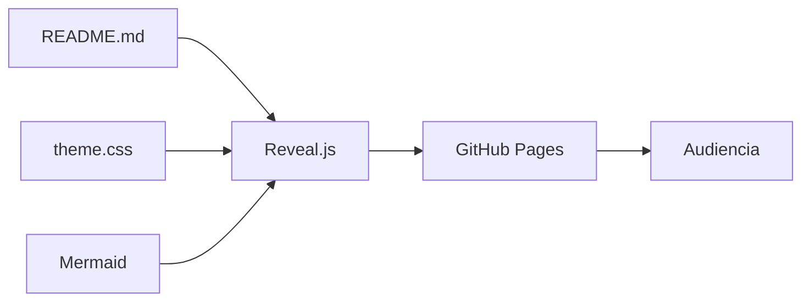
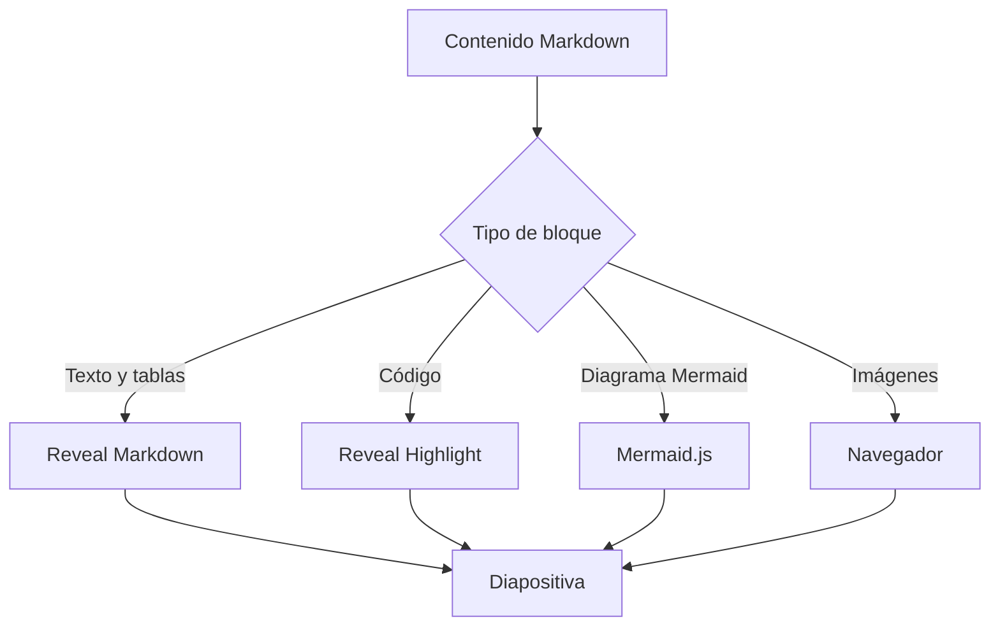
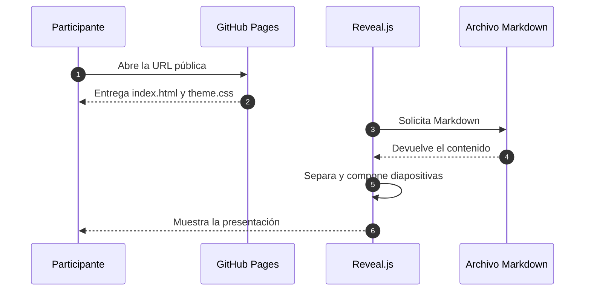
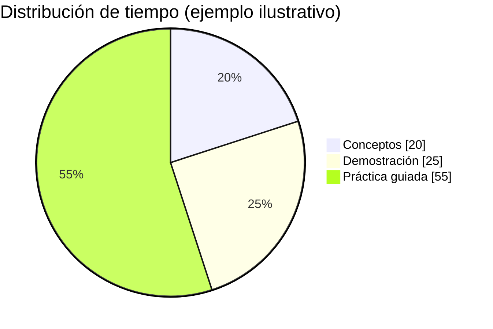

<!-- .slide: class="cover" data-background-color="#0B1020" -->

<div class="cover-card">
  <p class="cover-kicker">AI ENGINEERING WORKSHOP · 2026</p>
  <h1 class="cover-title" data-repo-title>Test</h1>
  <p class="cover-description">De un README a una presentación técnica interactiva</p>
  <div class="cover-separator"></div>
  <p class="cover-author">Jorge Jesús Quispe Villaverde</p>
  <p class="cover-role">AI Engineer · Applied AI Researcher · AI Mentor</p>
  <nav class="cover-socials" aria-label="Contacto del expositor">
    <a href="https://github.com/jorgektch" target="_blank" rel="noopener noreferrer" aria-label="GitHub: jorgektch">github.com/jorgektch</a>
    <a href="https://www.instagram.com/jorgektch" target="_blank" rel="noopener noreferrer" aria-label="Instagram: @jorgektch">@jorgektch</a>
    <a href="https://www.tiktok.com/@jorgektch" target="_blank" rel="noopener noreferrer" aria-label="TikTok: @jorgektch">@jorgektch</a>
    <a href="mailto:jorgektch@gmail.com" aria-label="Correo electrónico: jorgektch@gmail.com">jorgektch@gmail.com</a>
  </nav>
</div>

[▶ Ver las diapositivas](https://jorgektch.github.io/test/) · [Código del repositorio](https://github.com/jorgektch/test)

Note: Presenta el título de la charla, tu nombre completo y cómo el mismo README sirve como documentación y presentación. El título en Pages se ajusta automáticamente al nombre del repositorio.

---

## Una sola fuente, dos experiencias

**GitHub:** documentación navegable, código copiable, tablas e imágenes.

**GitHub Pages:** diapositivas Reveal.js con fuentes personalizadas, navegación y notas.

> La documentación no tiene por qué quedar separada del material de exposición.

**Objetivo:** enseñar los patrones visuales más comunes de una charla técnica usando solamente contenido del `README.md`.

---

## El recorrido del taller

| Bloque | Qué mostrarás | Formato |
| :--- | :--- | :--- |
| 01 | Idea y contexto | Texto + imagen |
| 02 | Cómo funciona | Arquitectura Mermaid |
| 03 | Qué ocurre en cada paso | Diagrama de secuencia |
| 04 | Alternativas | Tabla comparativa |
| 05 | Implementación | Código con resaltado |
| 06 | Práctica | Retos + notas del expositor |

**Pista:** usa las flechas `←` `→` y `↑` `↓`; presiona **S** para las notas.

---

## Primero, el contexto visual


Una fotografía ayuda a introducir un problema, humanizar una historia o separar bloques conceptuales.

<small>Imagen de ejemplo: [Unsplash](https://unsplash.com/). Puedes reemplazar la URL por una foto propia o por una imagen alojada en `assets/images/`.</small>

---

## Arquitectura: README → slides



**Idea clave:** Markdown almacena el contenido; CSS y JavaScript definen su presentación. GitHub también renderiza el diagrama Mermaid.

Note: Resalta que no se genera un PPTX. La presentación se muestra en el navegador y el contenido vive en el repositorio.

--

### Una vista más detallada



**Prueba:** en esta diapositiva vertical utiliza `↓` para profundizar y `↑` para volver.

---

## ¿Qué ocurre al abrir la presentación?



Estos diagramas son **código Mermaid editable** dentro del propio README.

---

## Gráficos de datos sin capturas de pantalla



Un gráfico Mermaid permite explicar proporciones sin crear una imagen adicional. **Estos valores son ficticios y únicamente ilustrativos.**

---

## Comparativa de formatos

| Necesidad | README en GitHub | Reveal.js en Pages | PPTX |
| :--- | :---: | :---: | :---: |
| Documentación y enlaces | ✅ | ✅ | ⚠️ |
| Código copiable | ✅ | ✅ | ⚠️ |
| Presentar con teclado | ❌ | ✅ | ✅ |
| Notas del ponente | ❌ | ✅ | ✅ |
| Contenido versionado con Git | ✅ | ✅ | ⚠️ |
| Edición visual tradicional | ❌ | ❌ | ✅ |

**Conclusión:** elige Reveal.js para mantener el contenido técnico versionado y presentarlo sin duplicar archivos.

---

## Patrones visuales: tres ideas

<div class="feature-grid">
  <div class="feature-card"><span class="card-kicker">01 · EXPLICAR</span><h3>Diagramas</h3><p>Comunican componentes, relaciones y procesos complejos con menos texto.</p></div>
  <div class="feature-card"><span class="card-kicker">02 · COMPARAR</span><h3>Tablas</h3><p>Sirven para contrastar decisiones, criterios, alternativas y resultados.</p></div>
  <div class="feature-card"><span class="card-kicker">03 · DEMOSTRAR</span><h3>Código</h3><p>Convierte una idea en un ejemplo ejecutable y verificable.</p></div>
</div>

El HTML ligero es compatible con Markdown y permite layouts especiales sin crear otro archivo de contenido.

---

## Código Python con resaltado

```python
def obtener_stock(nombre: str) -> dict:
    """Ejemplo simple de una herramienta de negocio."""
    inventario = {
        "bicicleta": {"stock": 3, "precio": 850},
        "casco": {"stock": 0, "precio": 120},
    }
    return inventario.get(
        nombre.strip().lower(),
        {"error": "Producto no encontrado"},
    )

print(obtener_stock("bicicleta"))
```

**Fuente de código:** JetBrains Mono. **Resaltado:** Reveal Highlight.

---

## Una imagen, una historia

<div class="image-text">
  <div class="image-side">
    
    <small>Fotografía: <a href="https://unsplash.com/">Unsplash</a></small>
  </div>
  <div class="text-side">
    <h3>Construir en equipo</h3>
    <p>Una imagen puede acompañar la explicación de un caso real sin competir con el contenido técnico.</p>
    <p><strong>Recomendación:</strong> una idea, una imagen y una conclusión breve.</p>
  </div>
</div>

---

## Una explicación paso a paso

1. Identifica un problema real. <!-- .element: class="fragment" -->
2. Diseña una solución pequeña. <!-- .element: class="fragment" -->
3. Construye y valida un primer prototipo. <!-- .element: class="fragment" -->
4. Mide resultados e itera. <!-- .element: class="fragment" -->

> Los fragmentos aparecen progresivamente en Reveal.js, aunque en GitHub se ven todos.

Note: Muestra cada punto uno por uno. Explica que HTML comments con .element y class fragment son instrucciones de Reveal.js, no contenido adicional que mantener.

---

## Ejercicio práctico

**Reto:** transforma un README técnico en una presentación de ocho diapositivas.

- Incluye una portada personalizada.
- Agrega un diagrama de arquitectura en Mermaid.
- Usa una tabla para comparar dos alternativas.
- Inserta al menos una imagen y un bloque de código.
- Añade notas del expositor en una diapositiva.

**Extra:** crea una diapositiva vertical con `--`.

---

## Cómo usar este visor con otro repositorio

1. Publica este repositorio mediante **GitHub Pages → main → / (root)**.
2. Abre [la presentación](https://jorgektch.github.io/test/).
3. Para cargar otro README **público**, usa `?url=` con la dirección de GitHub:

```text
https://jorgektch.github.io/test/?url=https://github.com/USUARIO/REPO/blob/main/README.md
```

Si copias `index.html` y `assets/theme.css` a otro repositorio, podrás usar el mismo tema. Su **nombre de repositorio** se convertirá automáticamente en el título de la carátula en la presentación.

---

## Personalización rápida

| Elemento | Dónde cambiarlo |
| :--- | :--- |
| Título para GitHub | `# Test` en este README |
| Título de la portada en slides | Se obtiene de la URL del repositorio |
| Nombre, redes y correo | Primer y último bloque del README; iconos en `assets/icons/` |
| Poppins, Lexend, JetBrains Mono | `assets/theme.css` e `index.html` |
| Colores de la carátula | Variables CSS en `assets/theme.css`: `#0B1020`, `#F5F7FF`, `#36E0C4`, `#AAB9D0` |
| Fotografías | URLs de imagen o `assets/images/` |
| Diagramas | Bloques de código `mermaid` |

**Nota:** las fotos remotas y las bibliotecas CDN requieren conexión a Internet. Los iconos de las redes se almacenan en este mismo repositorio. Los diagramas Mermaid se renderizan desde los bloques de código `mermaid` del README, sin necesidad de insertar SVG o capturas. El visor detecta estos bloques por su lenguaje **o** por la sintaxis del diagrama.

---

<!-- .slide: class="closing" -->

<div class="closing-card">
  <p class="cover-kicker">AI ENGINEERING WORKSHOP</p>
  <h1>¡Gracias!</h1>
  <p class="cover-author">Jorge Jesús Quispe Villaverde</p>
  <p class="cover-role">AI Engineer · Applied AI Researcher · AI Mentor</p>
  <nav class="cover-socials" aria-label="Contacto del expositor">
    <a href="https://github.com/jorgektch" target="_blank" rel="noopener noreferrer" aria-label="GitHub: jorgektch">github.com/jorgektch</a>
    <a href="https://www.instagram.com/jorgektch" target="_blank" rel="noopener noreferrer" aria-label="Instagram: @jorgektch">@jorgektch</a>
    <a href="https://www.tiktok.com/@jorgektch" target="_blank" rel="noopener noreferrer" aria-label="TikTok: @jorgektch">@jorgektch</a>
    <a href="mailto:jorgektch@gmail.com" aria-label="Correo electrónico: jorgektch@gmail.com">jorgektch@gmail.com</a>
  </nav>
  <p class="closing-question">¿Preguntas?</p>
</div>
