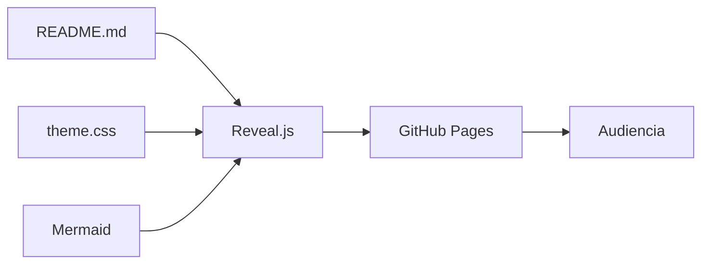
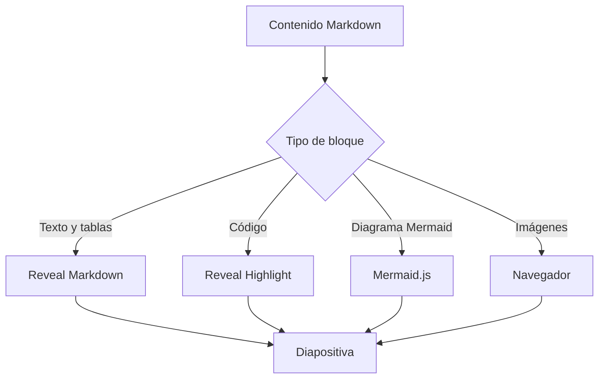
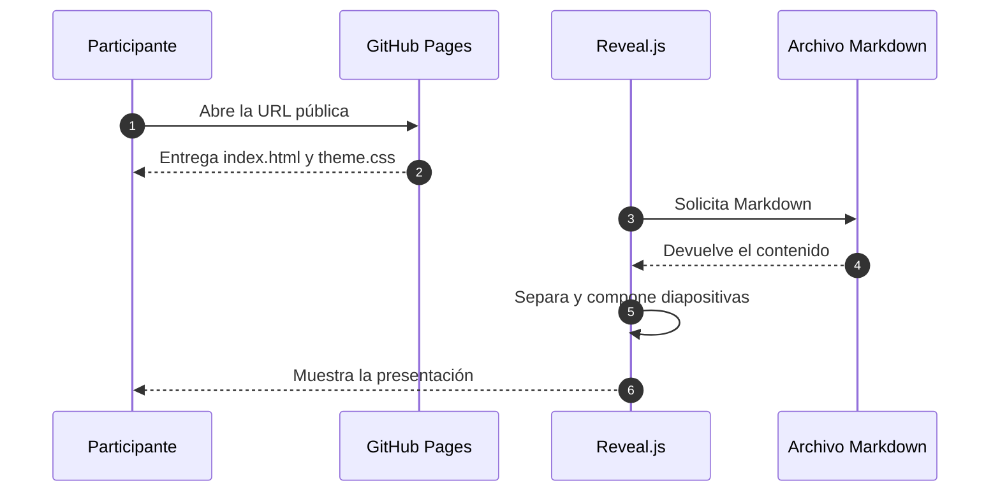
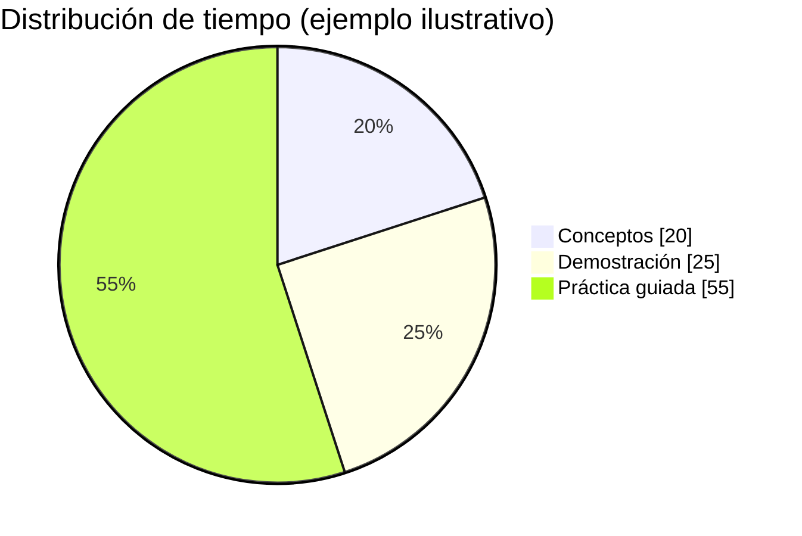

<!-- .slide: class="cover" data-background-color="#0B1020" -->

<div class="cover-card">
  <p class="cover-kicker">OPEN SOURCE · MARKDOWN PRESENTATIONS</p>
  <h1 class="cover-title" data-repo-title>README to Slides</h1>
  <p class="cover-description">Documenta y presenta desde Markdown, sin Canva, PowerPoint ni Google Slides.</p>
  <div class="cover-separator"></div>
  <p class="cover-author">Jorge Jesús Quispe Villaverde</p>
  <p class="cover-role">AI Engineer · Applied AI Researcher · AI Mentor</p>
  <div class="contact-row" aria-label="Contacto del expositor">
    <a class="contact-email" href="mailto:jorgektch@gmail.com">jorgektch@gmail.com</a>
    <div class="contact-socials" aria-label="Redes sociales de jorgektch">
      <a class="social-icon" href="https://github.com/jorgektch" target="_blank" rel="noopener noreferrer" aria-label="GitHub: jorgektch" title="GitHub"><i class="fa-brands fa-github" aria-hidden="true"></i><span class="social-label">GitHub</span></a>
      <a class="social-icon" href="https://www.instagram.com/jorgektch" target="_blank" rel="noopener noreferrer" aria-label="Instagram: jorgektch" title="Instagram"><i class="fa-brands fa-instagram" aria-hidden="true"></i><span class="social-label">Instagram</span></a>
      <a class="social-icon" href="https://www.tiktok.com/@jorgektch" target="_blank" rel="noopener noreferrer" aria-label="TikTok: jorgektch" title="TikTok"><i class="fa-brands fa-tiktok" aria-hidden="true"></i><span class="social-label">TikTok</span></a>
      <span class="social-handle">/jorgektch</span>
    </div>
  </div>
</div>

[▶ Ver las diapositivas](https://jorgektch.github.io/readme-to-slides/) · [Código del repositorio](https://github.com/jorgektch/readme-to-slides)

Note: Presenta README to Slides como una plantilla reutilizable. El mismo archivo sirve para documentación en GitHub y para exponer desde GitHub Pages. El visor toma el título de la ruta del repositorio.

---

## ¿Qué es README to Slides?

**Una plantilla para presentar desde el mismo `README.md` que documenta tu proyecto.** No convierte Markdown en un archivo `.pptx`: muestra diapositivas web interactivas con JavaScript.

**En GitHub:** documentación navegable, diagramas Mermaid, código copiable, tablas e imágenes.

**En GitHub Pages:** presentación con Reveal.js, navegación en dos dimensiones, diseño personalizable y notas del expositor.

> Una sola fuente Markdown; dos maneras de compartir tus ideas. Sin Canva, PowerPoint ni Google Slides.

---

## Qué puedes incluir en una presentación

| Bloque | Qué mostrarás | Formato |
| :--- | :--- | :--- |
| 01 | Idea y contexto | Texto + imagen |
| 02 | Cómo funciona | Arquitectura Mermaid |
| 03 | Qué ocurre en cada paso | Diagrama de secuencia |
| 04 | Alternativas | Tabla comparativa |
| 05 | Implementación | Código con resaltado |
| 06 | Práctica | Retos + notas del expositor |

**Navegación:** `←` `→` cambia de tema; `↑` `↓` abre o cierra detalles verticales; `Esc` u `O` activa la vista general; `S` muestra notas. El visor incluye un botón **Repo**.

---

## Primero, el contexto visual


Una fotografía ayuda a introducir un problema, humanizar una historia o separar bloques conceptuales.

<small>Imagen de ejemplo: [Unsplash](https://unsplash.com/). Puedes reemplazar la URL por una foto propia o por una imagen alojada en `assets/images/`.</small>

---

## Arquitectura: README → slides



**Idea clave:** Markdown almacena el contenido; CSS y JavaScript definen su presentación. GitHub también renderiza el diagrama Mermaid.

Note: Resalta que no se genera un PPTX. La presentación se muestra en el navegador y el contenido vive en el repositorio.

--

### Una vista más detallada



**Prueba:** en esta diapositiva vertical utiliza `↓` para profundizar y `↑` para volver.

---

## ¿Qué ocurre al abrir la presentación?



Estos diagramas son **código Mermaid editable** dentro del propio README.

---

## Gráficos de datos sin capturas de pantalla



Un gráfico Mermaid permite explicar proporciones sin crear una imagen adicional. **Estos valores son ficticios y únicamente ilustrativos.**

---

## Comparativa de formatos

| Necesidad | README en GitHub | Reveal.js en Pages | PPTX |
| :--- | :---: | :---: | :---: |
| Documentación y enlaces | ✅ | ✅ | ⚠️ |
| Código copiable | ✅ | ✅ | ⚠️ |
| Presentar con teclado | ❌ | ✅ | ✅ |
| Notas del ponente | ❌ | ✅ | ✅ |
| Contenido versionado con Git | ✅ | ✅ | ⚠️ |
| Edición visual tradicional | ❌ | ❌ | ✅ |

**Conclusión:** elige Reveal.js para mantener el contenido técnico versionado y presentarlo sin duplicar archivos.

---

## Patrones visuales: tres ideas

<div class="feature-grid">
  <div class="feature-card"><span class="card-kicker">01 · EXPLICAR</span><h3>Diagramas</h3><p>Comunican componentes, relaciones y procesos complejos con menos texto.</p></div>
  <div class="feature-card"><span class="card-kicker">02 · COMPARAR</span><h3>Tablas</h3><p>Sirven para contrastar decisiones, criterios, alternativas y resultados.</p></div>
  <div class="feature-card"><span class="card-kicker">03 · DEMOSTRAR</span><h3>Código</h3><p>Convierte una idea en un ejemplo ejecutable y verificable.</p></div>
</div>

El HTML ligero es compatible con Markdown y permite layouts especiales sin crear otro archivo de contenido.

---

## Código Python con resaltado

```python
def obtener_stock(nombre: str) -> dict:
    """Ejemplo simple de una herramienta de negocio."""
    inventario = {
        "bicicleta": {"stock": 3, "precio": 850},
        "casco": {"stock": 0, "precio": 120},
    }
    return inventario.get(
        nombre.strip().lower(),
        {"error": "Producto no encontrado"},
    )

print(obtener_stock("bicicleta"))
```

**Fuente de código:** JetBrains Mono. **Resaltado:** Reveal Highlight.

---

## Una imagen, una historia

<div class="image-text">
  <div class="image-side">
    
    <small>Fotografía: <a href="https://unsplash.com/">Unsplash</a></small>
  </div>
  <div class="text-side">
    <h3>Construir en equipo</h3>
    <p>Una imagen puede acompañar la explicación de un caso real sin competir con el contenido técnico.</p>
    <p><strong>Recomendación:</strong> una idea, una imagen y una conclusión breve.</p>
  </div>
</div>

---

## Una explicación paso a paso

1. Identifica un problema real. <!-- .element: class="fragment" -->
2. Diseña una solución pequeña. <!-- .element: class="fragment" -->
3. Construye y valida un primer prototipo. <!-- .element: class="fragment" -->
4. Mide resultados e itera. <!-- .element: class="fragment" -->

> Los fragmentos aparecen progresivamente en Reveal.js, aunque en GitHub se ven todos.

Note: Muestra cada punto uno por uno. Explica que HTML comments con .element y class fragment son instrucciones de Reveal.js, no contenido adicional que mantener.

---

## Ejercicio práctico

**Reto:** transforma un README técnico en una presentación de ocho diapositivas.

- Incluye una portada personalizada.
- Agrega un diagrama de arquitectura en Mermaid.
- Usa una tabla para comparar dos alternativas.
- Inserta al menos una imagen y un bloque de código.
- Añade notas del expositor en una diapositiva.

**Extra:** crea una diapositiva vertical con `--`.

---

## Dos maneras de utilizar esta plantilla

**Opción A · Tu propia presentación:** utiliza **Use this template** (cuando el repositorio esté marcado como plantilla), crea tu repositorio, modifica `README.md` y publica GitHub Pages desde `main` y `/(root)`. El título del visor se adapta al nombre de tu repositorio.

**Opción B · Visor para otro README público:** abre [la demostración](https://jorgektch.github.io/readme-to-slides/) y añade `?url=` con un archivo de GitHub:

```text
https://jorgektch.github.io/readme-to-slides/?url=https://github.com/USUARIO/REPO/blob/main/README.md
```

**Importante:** en el modo `?url=`, las imágenes con rutas relativas y los archivos locales del otro repositorio pueden necesitar URL absolutas. Los archivos Markdown deben ser públicos.

El diseño se controla con `assets/theme.css` e `index.html`. Los iconos de redes utilizan clases de Font Awesome, sin archivos SVG propios. No se requiere compilación de PowerPoint.

---

## Personalización rápida

| Elemento | Dónde cambiarlo |
| :--- | :--- |
| Título visible en GitHub | `<h1 class="cover-title">` de la carátula en `README.md` |
| Título de la portada en slides | Se obtiene del nombre del repositorio mediante `index.html` |
| Nombre, redes y correo | Primer y último bloque del README; iconos con Font Awesome vía CSS en el visor |
| Poppins, Lexend, JetBrains Mono | `assets/theme.css` e `index.html` |
| Colores de la carátula | Variables CSS en `assets/theme.css`: `#0B1020`, `#F5F7FF`, `#36E0C4`, `#AAB9D0` |
| Fotografías | URLs de imagen o `assets/images/` |
| Diagramas | Bloques de código `mermaid` |

**Notas:** las fotos remotas, las fuentes y las bibliotecas CDN requieren conexión a Internet. Font Awesome dibuja los iconos en Pages, mientras que GitHub muestra los enlaces de texto. Mermaid se renderiza desde los bloques `mermaid` del README. Al reutilizar la plantilla, reemplaza también el nombre, correo y enlaces del expositor en portada y cierre.

---

<!-- .slide: class="closing" -->

<div class="closing-card">
  <p class="cover-kicker">README TO SLIDES · OPEN SOURCE</p>
  <h1>¡Gracias!</h1>
  <p class="cover-author">Jorge Jesús Quispe Villaverde</p>
  <p class="cover-role">AI Engineer · Applied AI Researcher · AI Mentor</p>
  <p class="closing-question">¿Preguntas?</p>
  <div class="contact-row" aria-label="Contacto del expositor">
    <a class="contact-email" href="mailto:jorgektch@gmail.com">jorgektch@gmail.com</a>
    <div class="contact-socials" aria-label="Redes sociales de jorgektch">
      <a class="social-icon" href="https://github.com/jorgektch" target="_blank" rel="noopener noreferrer" aria-label="GitHub: jorgektch" title="GitHub"><i class="fa-brands fa-github" aria-hidden="true"></i><span class="social-label">GitHub</span></a>
      <a class="social-icon" href="https://www.instagram.com/jorgektch" target="_blank" rel="noopener noreferrer" aria-label="Instagram: jorgektch" title="Instagram"><i class="fa-brands fa-instagram" aria-hidden="true"></i><span class="social-label">Instagram</span></a>
      <a class="social-icon" href="https://www.tiktok.com/@jorgektch" target="_blank" rel="noopener noreferrer" aria-label="TikTok: jorgektch" title="TikTok"><i class="fa-brands fa-tiktok" aria-hidden="true"></i><span class="social-label">TikTok</span></a>
      <span class="social-handle">/jorgektch</span>
    </div>
  </div>
</div>
