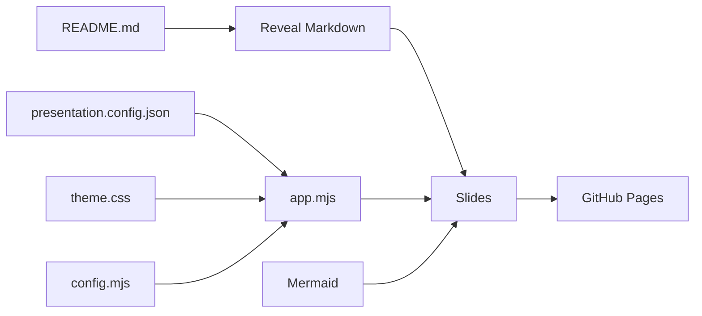

# How it works

- `index.html` loads Reveal.js and its Markdown, Highlight and Notes plugins.
- `assets/js/config.mjs` validates configuration and resolves URLs.
- `assets/js/app.mjs` loads JSON and Markdown, initializes the deck, and activates navigation and diagrams.
- Mermaid blocks remain ordinary fenced code in GitHub, and are converted to SVG only in the presentation.
- `README.md` remains the single authored content file, while JSON config and CSS control its appearance.

## Constraints

This is a **browser-rendered slide deck**, not a PPTX generator. Fonts, images, Reveal.js, Mermaid and Font Awesome are fetched over the network. For fully offline presentations, vendor these dependencies and replace external images/links.

The local cover is populated with `presentation.config.json` at runtime. GitHub displays the literal fallback text from the README (which you can edit separately). See [Customization](CUSTOMIZATION.md) and [Security](../SECURITY.md).
