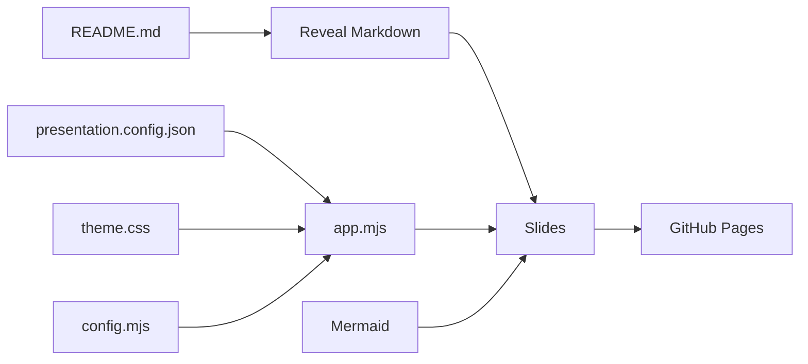

# How it works

- `index.html` loads Reveal.js and its Markdown, Highlight and Notes plugins.
- `assets/js/config.mjs` validates configuration and resolves URLs.
- `assets/js/app.mjs` loads JSON and Markdown, initializes the deck, and activates navigation and diagrams.
- Mermaid blocks remain ordinary fenced code in GitHub, and are converted to SVG only in the presentation.
- `README.md` remains the single authored content file, while JSON config and CSS control its appearance.

## Constraints

This is a **browser-rendered slide deck**, not a PPTX generator. Fonts, images, Reveal.js, Mermaid and Font Awesome are fetched over the network. For fully offline presentations, vendor these dependencies and replace external images/links.

The local cover is populated with `presentation.config.json` at runtime. GitHub displays the literal fallback text from the README (which you can edit separately). See [Customization](CUSTOMIZATION.md) and [Security](../SECURITY.md).

## v1.2 multimedia and themes

- `assets/js/theme.mjs` contains the dark/light palettes and CSS tokens; `app.mjs` selects the effective mode and rerenders Mermaid diagrams on changes.
- `assets/js/media.mjs` parses approved video URL formats into safe YouTube/Vimeo iframe URLs or direct media files. `app.mjs` embeds recognized Markdown links and loads/pauses the player when a slide becomes visible/hidden.
- `presentation.config.json` now includes `theme.mode`, `theme.lightColors`, `theme.showToggle` and `media` settings.
- The README remains meaningful in GitHub, since its video references remain Markdown hyperlinks.

## Context-aware navigation

`assets/js/navigation.mjs` owns navigation **visibility** (auto-hide, pointer
proximity, focus and touch reveal button). Directional actions stay in
`assets/js/app.mjs` using Reveal.js APIs. This separates toolbar accessibility
from the slide content and presentation theme. The counter is independent of
both components.
